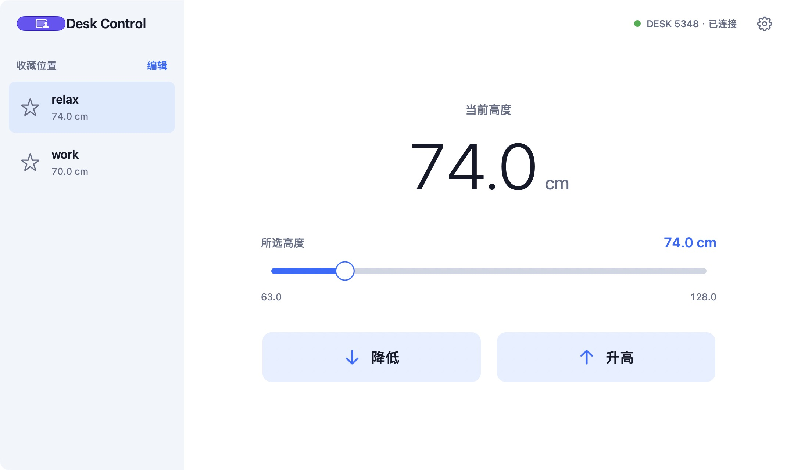

# Desk Control

[English](README.en.md) · [下载](https://github.com/Liu-Da/desk-ctrl/releases) · [反馈问题](https://github.com/Liu-Da/desk-ctrl/issues)

通过蓝牙控制 LINAK 升降桌的原生 macOS 应用。使用 SwiftUI + CoreBluetooth，支持 macOS 13 或更新版本，无第三方运行依赖。

- 实时读取桌面高度，按住升高／降低，或拖动滑条前往目标高度。
- 为每台桌子保存 0–5 个收藏位置，独立设置高度校准和控制范围。
- 记住上次连接的桌子，启动时自动重连。
- 关闭主窗口后驻留菜单栏，可从菜单栏查看高度和切换收藏。
- 在数据中断、超时、无移动、到达边界和桌子错误时停止发送移动指令。

已实机验证的面板型号为 **LINAK DPG1C-C005-01**。其他 LINAK 蓝牙面板或桌子可能兼容，尚未逐一验证。本项目由社区独立开发，与 LINAK 无隶属关系。



*1.2.0 实机截图；收藏名称和高度由用户设置。*

## 下载与安装

从 [GitHub Releases](https://github.com/Liu-Da/desk-ctrl/releases) 下载 DMG，打开后将 **Desk Control** 拖到 **Applications（应用程序）**，推出 DMG，再从「应用程序」打开。

首个发布包面向 **Apple Silicon（M 系列）Mac**。Intel Mac 可在本机从源码构建；请以对应 Release 的架构说明为准。

当前构建使用本地临时签名，未经过 Apple 公证。首次打开如果系统阻止运行，可在「系统设置 → 隐私与安全性」中查看该应用的打开选项，也可以从源码自行构建。

## 从源码构建

开发需要 Swift 6 工具链，例如 Xcode 16 或更新版本及其命令行工具。测试使用工具链内置的 [Swift Testing](https://github.com/swiftlang/swift-testing)。

```sh
git clone https://github.com/Liu-Da/desk-ctrl.git
cd desk-ctrl
./scripts/check.sh
./scripts/build.sh
./scripts/package-dmg.sh
```

构建副本保存在 `dist/Desk Control.app`，供开发和打包使用。
DMG 在 `dist/Desk-Control-1.2.1.dmg`；脚本从应用版本号生成文件名，并构建当前 Mac 的原生架构。
安装后，日常使用从「应用程序」打开：

```sh
open "/Applications/Desk Control.app"
```

打包脚本会校验镜像、挂载后检查应用签名、应用内容和安装快捷方式。
应用图标使用已确认的暖白与石墨灰设计，源图为 `Resources/AppIcon.png`；构建时自动生成包含各尺寸的 `AppIcon.icns`。

## 连接与使用

1. 在 macOS 弹窗中允许 **Desk Control** 使用蓝牙。
2. 长按桌子面板的蓝牙键 **2 秒**，直到蓝灯闪烁；屏幕显示 `DESK` 和四位编号。
3. 在程序中扫描并连接相同编号的桌子。若手机正在连接桌子，请先断开手机。
4. 核对程序高度与桌子面板。如果基础高度不能自动读取，点右上角设置，在「高度校准与范围」里填入面板当前高度并点「校准」。
5. 按住升高／降低，松开即发送停止。按 Esc 或 ⌘. 也会发送停止。
6. 拖动滑条选择高度，松开后前往该高度。拖动过程中只改变所选数值，不发送目标高度；切换窗口或按 Esc 会取消本次选择。
7. 点左侧「编辑」进入收藏编辑窗口，用 ＋ 新增，填写名称、高度或点「使用当前高度」，最后点「保存」。点击主界面的收藏即可前往。

收藏支持 **0–5 个**，默认名称为「收藏 1」至「收藏 5」，仅在用户改名后显示自定义名称。新增、删除、改名和更新高度都在编辑窗口中完成；取消会放弃本次编辑。零个收藏时主界面的列表留空。
已有坐姿／站姿预设会保留高度并迁移为默认编号的收藏。收藏、校准和应用的高度范围按每台桌子的蓝牙 UUID 分别保存在本机；收藏不会写入桌子面板的记忆位置。
默认应用范围为 **60–130 cm**，可根据自己的桌子调整。范围只是本程序的控制边界，无法改变桌子硬件行程。
连接和扫描不会触发升降。DPG1C 用户标识初始化仅将其启用位设为 1，并保留标识的其他字节。

## 自动重连与菜单栏

首次连接成功后，程序记住这台桌子的蓝牙 UUID 和名称。下次打开应用，蓝牙就绪后会自动重连；若系统缓存的连接失败，最多再扫描并尝试连接一次相同 UUID 的桌子，不会按名称连接附近其他桌子。桌子暂时不可用时，可以从菜单栏点「重新连接」，或在设置中手动扫描。主动断开后，本次运行不会立即自动重连。

菜单栏的桌子图标提供实时高度、当前桌子的收藏档位、打开主窗口和退出入口。桌子名称旁的绿色圆点表示已连接，连接中为橙色，未连接为灰色；正常连接时不再单独显示「已连接」文字。收藏支持的数量、名称、高度与完整界面保持同步。点「打开主窗口」会打开或恢复唯一的完整窗口。

关闭主窗口后，程序继续驻留菜单栏并保留蓝牙连接；点「退出 Desk Control」或 ⌘Q 才退出。菜单栏发起的收藏移动在收起菜单、切换应用后继续执行；主窗口发起的移动仍在窗口失焦或关闭时停止。主窗口中的 Esc／⌘.、睡眠、退出和原有监测条件也会停止移动。每次重新连接都不会恢复旧的移动。

上述偏好由 `UserDefaults.standard` 保存在 `~/Library/Preferences/local.liuda.desk-control.plist`。`lastConnectedDesk` 是包含 UUID 和名称的 JSON 数据；每台桌子的收藏仍使用 `desk.<UUID>.favorites`，校准和范围使用同一 UUID 下的独立键。相同应用标识的版本升级保留这些设置。

## 停止处理

程序每 0.3 秒续发升降指令；按住升降后松开、主窗口操作时失焦、退出程序、睡眠、碰撞／错误通知会停止续发并尝试发送停止指令。菜单栏发起的收藏移动允许在后台继续。
高度数据超过 2 秒未更新、移动中 3 秒无高度变化、单次超过 45 秒、到达高度边界也会结束移动。
蓝牙失联时无法保证停止包送达；LINAK 的续发指令本身有短时间有效期。操作时留意桌子的实际运动，面板仍可直接操作。
重新连接后不会恢复之前的移动。

## 验证与诊断

```sh
./scripts/check.sh
open "/Applications/Desk Control.app" --args --diagnostics /tmp/desk-control-diagnostics.json
```

设置中的「复制诊断」提供蓝牙权限、连接状态、发现的桌子、接口和最近日志；诊断文件只在指定本地路径更新。
14 项单元测试覆盖字节协议、单位、设备筛选、无效目标、停止边界、超时、数据中断、无移动检测，收藏迁移、删除至空、改名、数量限制和每台桌子的存储隔离，以及记住最近桌子、损坏数据拒绝、重连 UUID 核对和有界重试。

项目开发记录中，2026-10-06 至 2026-10-07 已在上述 DPG1C 面板上验证蓝牙连接、基础高度读取、实时高度更新、停止指令、自动重连、收藏恢复和关闭／恢复主窗口后保留连接。实机结果只覆盖这一面板型号；单元测试和 CI 不代替硬件验证。

诊断内容可能包含桌子的蓝牙 UUID、名称、收藏和日志；提交 Issue 前请移除不希望公开的信息。

## 项目结构与贡献

| 路径 | 内容 |
| --- | --- |
| `Sources/DeskCore` | LINAK 字节协议、移动监测、收藏与重连数据 |
| `Sources/DeskControl` | SwiftUI 界面、CoreBluetooth 连接和菜单栏 |
| `Tests/DeskCoreTests` | 协议、停止处理和本机存储测试 |
| `Resources` | 应用信息和图标 |
| `scripts` | 测试、应用构建和 DMG 打包 |

欢迎通过 Issue 报告兼容性和问题，通过 Pull Request 提交改进。开发与验证步骤见 [CONTRIBUTING.md](CONTRIBUTING.md)。GitHub Actions 会在 Apple Silicon 和 Intel macOS runner 上运行测试、构建应用并检查签名。

## 协议依据

- [LINAK DPG1C 官方配对与使用说明](https://www.linak.com/work-res/start/dpg1c)
- [rhyst/linak-controller 的 GATT 定义](https://github.com/rhyst/linak-controller/blob/master/linak_controller/gatt.py)
- [rhyst/linak-controller 的 DPG1C 初始化流程](https://github.com/rhyst/linak-controller/blob/master/linak_controller/desk.py)
- [jechtom/linak-desk-client 的协议记录](https://github.com/jechtom/linak-desk-client/blob/master/protocol.md)

本项目是按公开协议编写的独立 Swift 实现。感谢上述项目公开协议资料；仓库没有引入其运行依赖。

## 许可证

[MIT License](LICENSE) · Copyright © 2026 LiuDa。
